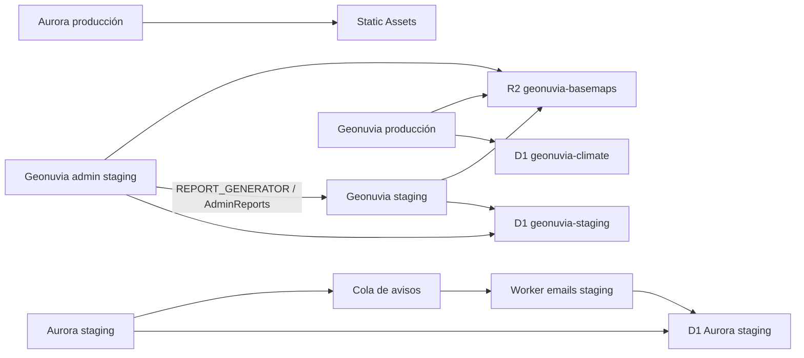

# Inventario de Cloudflare: Aurora Masajista y Geonuvia

Consulta: 25 de octubre de 2026 a las 12:03 (Europe/Madrid). Cuenta: `ef56a3d28dc0132beea7873e6688dee7`.

Fuente: recursos reales consultados con cf CLI y contrastados con las configuraciones locales. Solo lectura. No se modificó Cloudflare ni se leyeron valores de secretos, filas de clientes, objetos R2 o contenidos de correo.

## Resumen

| Recurso | Cantidad |
| --- | --- |
| zones | 2 |
| workers | 6 |
| d1 | 3 |
| r2 | 1 |
| queues | 1 |
| turnstile | 1 |
| accessApplications | 8 |
| accessReusablePolicies | 2 |
| identityProviders | 1 |
| workerBuilds | 5 |
| dnsRecords | 18 |
| certificatePacks | 9 |
| emailSendingSubdomains | 1 |

## Dominios y zonas

| Zona | ID | Estado | Plan | DNS | Nameservers |
| --- | --- | --- | --- | --- | --- |
| auroramasajista.com | `014dbec7389685f34cadc60b44b45fc2` | active | Free Website | 3 | grace.ns.cloudflare.com, nash.ns.cloudflare.com |
| geonuvia.com | `c03736aba92b82d052c648ad807ad3d8` | active | Free Website | 15 | grace.ns.cloudflare.com, nash.ns.cloudflare.com |

Aurora staging vive dentro de la zona geonuvia.com. Que ambas zonas sean Free no implica que Workers y R2 tengan un límite gratuito de facturación: son suscripciones de cuenta compartidas.

## Workers

| Worker | Uso | Dominios | CPU explícita | Logs / trazas | workers.dev / previews |
| --- | --- | --- | --- | --- | --- |
| `masajes-aurora-staging` | Web y reservas de staging con Access | aurora-staging.geonuvia.com | 100 ms | 1% / 1% | Off / Off |
| `masajes-aurora-email-staging` | Consumidor de la cola de emails de staging | Sin dominio HTTP | 1000 ms | 1% / 1% | Off / Off |
| `masajes-aurora` | Producción estática pública; solo assets, sin módulo ejecutable | auroramasajista.com, www.auroramasajista.com | No definida en versión | Desactivados | Off / Off |
| `geonuvia-staging` | Aplicación de staging y servicio privado de informes | staging.geonuvia.com | No definida en versión | 100% / 10% | Off / Off |
| `geonuvia-admin-staging` | Panel privado de administración de staging | admin-staging.geonuvia.com | No definida en versión | 100% / 10% | Off / Off |
| `geonuvia` | Aplicación de producción, actualmente privada por Access | geonuvia.com, www.geonuvia.com | No definida en versión | 100% / 10% | Off / Off |

La ausencia de CPU explícita en Geonuvia no significa CPU ilimitada: se aplica el límite de plataforma. Todos los Workers inventariados usan el modelo standard. En producción Aurora no hay código propio que ejecutar ni observabilidad de aplicación.

### masajes-aurora-staging

ID: `df62a96eab1843bab452d7727bd6866c`. Versión activa: `e90c4b9b-a973-48b3-8b0d-62ce42cbecf7` (100% del tráfico). Despliegue: 2026-10-25T10:43:36.316898Z. Compatibilidad: 2026-10-11.

| Binding | Tipo | Destino |
| --- | --- | --- |
| `ACCESS_AUD` | plain_text | — |
| `ACCESS_EMAIL` | plain_text | — |
| `ACCESS_MODE` | plain_text | — |
| `ACCESS_TEAM_DOMAIN` | plain_text | — |
| `ADMIN_EMAIL` | plain_text | — |
| `ASSETS` | assets | — |
| `DB` | d1 | 1c265507-1692-42e5-8b11-a6bc9d2b9802 |
| `EMAIL_FROM` | plain_text | — |
| `LOCAL_DEV` | plain_text | — |
| `NOTIFICATIONS` | queue | masajes-aurora-notifications-staging |
| `SITE_URL` | plain_text | — |
| `TURNSTILE_SECRET_KEY` | secret_text | — |

Secretos: `TURNSTILE_SECRET_KEY`.

### masajes-aurora-email-staging

ID: `8881e72c9d5e460999cc69a44392fc0a`. Versión activa: `2f350665-8bc6-4ca5-85af-9447b4858687` (100% del tráfico). Despliegue: 2026-10-25T10:43:15.792676Z. Compatibilidad: 2026-10-11.

| Binding | Tipo | Destino |
| --- | --- | --- |
| `ADMIN_EMAIL` | plain_text | — |
| `DB` | d1 | 1c265507-1692-42e5-8b11-a6bc9d2b9802 |
| `EMAIL_FROM` | plain_text | — |
| `RESEND_API_KEY` | secret_text | — |

Secretos: `RESEND_API_KEY`.

### masajes-aurora

ID: `89c513c85b0846818df4fdf4af476697`. Versión activa: `493b8648-1d35-4a0c-af1f-7d5f244c2039` (100% del tráfico). Despliegue: 2026-10-25T10:41:31.291864Z. Compatibilidad: 2026-10-11.

| Binding | Tipo | Destino |
| --- | --- | --- |

Secretos: Ninguno.

### geonuvia-staging

ID: `7c6dff4d05f544dfbcf80ed1757a0826`. Versión activa: `4af609bc-afe5-473e-97e2-7600f52976d6` (100% del tráfico). Despliegue: 2026-10-11T09:07:36.85196Z. Compatibilidad: 2026-10-04.

| Binding | Tipo | Destino |
| --- | --- | --- |
| `APP_ENV` | plain_text | — |
| `APP_ORIGIN` | secret_text | — |
| `ASSETS` | assets | — |
| `BASEMAPS` | r2_bucket | geonuvia-basemaps |
| `CLIMATE_DB` | d1 | 60427671-7c00-424c-8fd4-f78b2b995a52 |
| `EMAIL_ALLOWLIST` | secret_text | — |
| `EMAIL_DELIVERY_MODE` | plain_text | — |
| `GEOAPIFY_API_KEY` | secret_text | — |
| `RADON_VERSION` | plain_text | — |
| `RAPIDAPI_KEY` | secret_text | — |
| `RESEND_API_KEY` | secret_text | — |
| `RESEND_FROM` | secret_text | — |
| `RESEND_TEMPLATE_ID` | secret_text | — |
| `STRIPE_API_KEY` | secret_text | — |
| `STRIPE_PRODUCT_ID` | plain_text | — |
| `STRIPE_WEBHOOK_SECRET` | secret_text | — |

Secretos: `APP_ORIGIN`, `EMAIL_ALLOWLIST`, `GEOAPIFY_API_KEY`, `RAPIDAPI_KEY`, `RESEND_API_KEY`, `RESEND_FROM`, `RESEND_TEMPLATE_ID`, `STRIPE_API_KEY`, `STRIPE_WEBHOOK_SECRET`.

### geonuvia-admin-staging

ID: `8f1d6f6f44f14ab5897be963b3975a4e`. Versión activa: `dfee8e11-1569-4652-b958-bc10d5cb6533` (100% del tráfico). Despliegue: 2026-10-11T09:07:09.061271Z. Compatibilidad: 2026-10-11.

| Binding | Tipo | Destino |
| --- | --- | --- |
| `ACCESS_AUD` | plain_text | — |
| `ACCESS_TEAM_DOMAIN` | plain_text | — |
| `ADMIN_ORIGIN` | plain_text | — |
| `APP_ENV` | plain_text | — |
| `ASSETS` | assets | — |
| `BASEMAPS` | r2_bucket | geonuvia-basemaps |
| `CLIMATE_DB` | d1 | 60427671-7c00-424c-8fd4-f78b2b995a52 |
| `LOCAL_DEV` | plain_text | — |
| `REPORT_GENERATOR` | service | geonuvia-staging |

Secretos: Ninguno.

### geonuvia

ID: `7505175e051c4220982cb14e35176ff8`. Versión activa: `2bb0594d-ef92-4879-bcc3-976edb8ee345` (100% del tráfico). Despliegue: 2026-10-11T07:57:29.406985Z. Compatibilidad: 2026-10-04.

| Binding | Tipo | Destino |
| --- | --- | --- |
| `APP_ENV` | plain_text | — |
| `APP_ORIGIN` | secret_text | — |
| `ASSETS` | assets | — |
| `BASEMAPS` | r2_bucket | geonuvia-basemaps |
| `CLIMATE_DB` | d1 | c2c69f84-2063-4591-9163-c65c71959ed8 |
| `EMAIL_ALLOWLIST` | plain_text | — |
| `EMAIL_DELIVERY_MODE` | plain_text | — |
| `GEOAPIFY_API_KEY` | secret_text | — |
| `RADON_ENABLED` | plain_text | — |
| `RADON_VERSION` | plain_text | — |
| `RESEND_API_KEY` | secret_text | — |
| `RESEND_FROM` | secret_text | — |
| `RESEND_TEMPLATE_ID` | secret_text | — |
| `STRIPE_API_KEY` | secret_text | — |
| `STRIPE_PRODUCT_ID` | plain_text | — |
| `STRIPE_WEBHOOK_SECRET` | secret_text | — |

Secretos: `APP_ORIGIN`, `GEOAPIFY_API_KEY`, `RESEND_API_KEY`, `RESEND_FROM`, `RESEND_TEMPLATE_ID`, `STRIPE_API_KEY`, `STRIPE_WEBHOOK_SECRET`.

## Bases de datos D1

| Base | Entorno y usuarios | ID | Tamaño | Tablas | Región |
| --- | --- | --- | --- | --- | --- |
| masajes-aurora-staging | Aurora web + emails staging | `1c265507-1692-42e5-8b11-a6bc9d2b9802` | 0.14 MiB | 11 | WEUR |
| geonuvia-staging | Geonuvia staging + admin | `60427671-7c00-424c-8fd4-f78b2b995a52` | 41.98 MiB | 18 | WEUR |
| geonuvia-climate | Geonuvia producción | `c2c69f84-2063-4591-9163-c65c71959ed8` | 39.09 MiB | 15 | WEUR |

Las tres tienen replicación de lectura desactivada. No se consultaron filas. Los contadores de tablas proceden del endpoint de detalle, no del listado (que devolvía ceros). El campo técnico D1 version=production no identifica el entorno de la aplicación. Aurora producción no tiene D1; los IDs de desarrollo local no son bases remotas adicionales.

## Almacenamiento R2

- Bucket: `geonuvia-basemaps`, creado 2026-10-05T17:32:38.988Z.

- Compartido por geonuvia, geonuvia-staging y geonuvia-admin-staging mediante BASEMAPS.

- Dominio administrado: `pub-fc2d38ca4a2945379a539b57785b0445.r2.dev`; acceso público deshabilitado.

- Dominios personalizados: 0. No se enumeraron objetos ni su volumen total.

## Colas y tareas

- Cola: `masajes-aurora-notifications-staging`; ID `66331bcd7038419aac1a43c68d390a7f`.

- Productor: masajes-aurora-staging. Consumidor: masajes-aurora-email-staging.

- Retención: 96 h. Lote: 5; concurrencia máxima: 1; reintentos: 5; espera entre reintentos: 60 s.

- Cron de Aurora staging: * * * * * (cada minuto), confirmado en la configuración y en el despliegue del 25 de octubre. Ejecuta mantenimiento/retención y despacho de avisos. No hay cron de Aurora producción. No se obtuvo un listado remoto independiente de todos los cron manuales de la cuenta.

## Access y autenticación

Organización: Geonuvia. Dominio: `geonuvia.cloudflareaccess.com`.

| Aplicación | Dominio/ruta | Decisión | Políticas | Sesión |
| --- | --- | --- | --- | --- |
| Masajes Aurora staging | aurora-staging.geonuvia.com | allow | Aurora staging owner only | 24h |
| Geonuvia staging admin | admin-staging.geonuvia.com | allow | Owner only | 24h |
| Geonuvia staging private | staging.geonuvia.com | allow | Owner only | 24h |
| Geonuvia staging webhook subpaths private | staging.geonuvia.com/api/stripe/webhook/* | allow | Owner only | 24h |
| Geonuvia staging Stripe webhook only | staging.geonuvia.com/api/stripe/webhook | bypass | Geonuvia staging signed Stripe webhook | 24h |
| Geonuvia Stripe webhook only | geonuvia.com/api/stripe/webhook | bypass | Geonuvia signed Stripe webhook | 24h |
| Geonuvia private development | geonuvia.com | allow | Owner only | 24h |
| Geonuvia webhook subpaths private | geonuvia.com/api/stripe/webhook/* | allow | Owner only | 24h |

Geonuvia producción sigue restringida por Access. Las rutas exactas de webhook Stripe tienen bypass de Access y dependen de la validación de firma de la aplicación. Los subpaths de esas rutas vuelven a quedar privados. Aurora producción no tiene aplicación Access.

| Proveedor | Tipo | ID |
| --- | --- | --- |
| Geonuvia email PIN | onetimepin | `5fc9bf25-64a3-4dc7-b576-ee8944248ffd` |

| Política reutilizable | Decisión | ID |
| --- | --- | --- |
| Aurora staging owner only | allow | `9eb60042-5a48-4d4b-b44e-8e1714f81b39` |
| Geonuvia signed Stripe webhook | bypass | `e7328a01-4338-47db-8348-eb759bbd3058` |

Las otras políticas aparecen adjuntas a sus aplicaciones. La propiedad de cuenta enforce_twofactor es false: no se exige 2FA globalmente; esto no demuestra si el usuario individual la tiene activada.

## Turnstile

| Widget | Modo | Dominios | Sitekey pública |
| --- | --- | --- | --- |
| Masajes Aurora staging bookings | managed | 127.0.0.1, aurora-staging.geonuvia.com, localhost | `0x4AAAAAAFT-f2HdGu1BnZxw` |

Hay un solo widget: reservas de Aurora staging y desarrollo local. No se encontró un widget adicional de Geonuvia ni de Aurora producción.

## Seguridad y reglas de zona

### auroramasajista.com

SSL: full; certificado activo: active. Always Use HTTPS: off; TLS mínimo: 1.0; nivel de seguridad: medium. Bot Fight Mode: false. Estos son ajustes de zona, no una prueba de los redirects propios de cada aplicación.

| Fase | Regla | Acción | ID |
| --- | --- | --- | --- |
| http_request_dynamic_redirect | Aurora: redirect www without invoking a Worker | redirect | `8fa3560775a64b939900eb822f35f3ef` |
| http_request_firewall_custom | Aurora: static website accepts GET and HEAD only | block | `11e949427a584c1c9edffb2fdf868da7` |
| http_request_firewall_custom | Aurora: block probes for secrets and nonexistent WordPress | block | `bcde0762138746c29fea9356ec9dc86a` |
| http_ratelimit | Aurora: 200 requests per IP per 10 seconds; verified bots excluded | block | `712b446d3a754e01a6ce66b30d4a66c8` |

- `aurora_www_canonical`: `http.host eq "www.auroramasajista.com"`

- `aurora_static_methods`: `(http.host in {"auroramasajista.com" "www.auroramasajista.com"} and not http.request.method in {"GET" "HEAD"})`

- `aurora_scanner_paths`: `(http.host in {"auroramasajista.com" "www.auroramasajista.com"} and (starts_with(lower(http.request.uri.path), "/.env") or starts_with(lower(http.request.uri.path), "/.git") or starts_with(lower(http.request.uri.path), "/wp-admin") or lower(http.request.uri.path) in {"/wp-login.php" "/xmlrpc.php"}))`

- `aurora_public_burst_limit`: `(http.host in {"auroramasajista.com" "www.auroramasajista.com"} and not cf.client.bot)`

  Límite: 200/10s; bloqueo 10s; claves cf.colo.id, ip.src.

Rulesets administrados enumerados: Cloudflare Normalization Ruleset (http_request_sanitize); Cloudflare Managed Response Firewall Default (http_response_firewall_custom); Cloudflare Managed Free Ruleset (http_request_firewall_managed); DDoS L7 ruleset (ddos_l7). No son reglas personalizadas creadas por el proyecto.

### geonuvia.com

SSL: full; certificado activo: active. Always Use HTTPS: off; TLS mínimo: 1.0; nivel de seguridad: medium. Bot Fight Mode: false. Estos son ajustes de zona, no una prueba de los redirects propios de cada aplicación.

| Fase | Regla | Acción | ID |
| --- | --- | --- | --- |
| http_ratelimit | Geonuvia address search, summary and checkout: 20 requests per IP per 10 seconds | block | `5058aac9818d4cb3a7a2cbea4e597ec4` |

- `5058aac9818d4cb3a7a2cbea4e597ec4`: `http.request.uri.path in {"/api/cartociudad/candidates" "/api/report/summary" "/api/stripe/checkout"}`

  Límite: 20/10s; bloqueo 10s; claves cf.colo.id, ip.src.

Rulesets administrados enumerados: Cloudflare Normalization Ruleset (http_request_sanitize); Cloudflare Managed Response Firewall Default (http_response_firewall_custom); Cloudflare Managed Free Ruleset (http_request_firewall_managed); DDoS L7 ruleset (ddos_l7). No son reglas personalizadas creadas por el proyecto.

## Despliegues automáticos y repositorios

| Worker | Repositorio GitHub | Rama | Build | Deploy | Auto / previews |
| --- | --- | --- | --- | --- | --- |
| masajes-aurora-staging | nasuke0302/masajes-aurora | staging | npm run build:cloudflare | npm exec -- cf deploy --mode staging --prebuilt | true / false |
| masajes-aurora-email-staging | Sin Workers Builds | — | — | Vía deploy local junto al staging | — |
| masajes-aurora | nasuke0302/masajes-aurora | main | npm run build:production && npm run test:production | cd .cloudflare/production && node ../../node_modules/cf/bin/cf deploy --mode production --prebuilt | true / false |
| geonuvia-staging | nasuke0302/geonuvia | staging | npm run ci:staging | npm run release:staging | true / false |
| geonuvia-admin-staging | nasuke0302/geonuvia-admin | staging | npm run build:staging | npm run deploy:ci | true / false |
| geonuvia | nasuke0302/geonuvia | main | npm run build | npm exec -- cf deploy --prebuilt | true / false |

El consumidor de emails no tiene conexión independiente a Workers Builds; el API devuelve el 404 esperado. Se publica mediante el pipeline local. Una configuración de CI no certifica que los cambios locales estén ya en su rama remota.

## DNS

El JSON adjunto conserva los valores DNS completos. En esta tabla se resumen los TXT para evitar ocupar páginas con claves públicas DKIM.

### auroramasajista.com

| Tipo | Nombre | Contenido | Proxy | TTL |
| --- | --- | --- | --- | --- |
| TXT | auroramasajista.com | TXT público; valor completo en JSON | No | 3600 |
| AAAA | auroramasajista.com | 100:: | Sí | Auto |
| AAAA | www.auroramasajista.com | 100:: | Sí | Auto |

### geonuvia.com

| Tipo | Nombre | Contenido | Proxy | TTL |
| --- | --- | --- | --- | --- |
| CNAME | rsend.orders.geonuvia.com | rsend-euw1.forge.rmta.net | No | Auto |
| CNAME | send.orders.geonuvia.com | send.forge.rmta.net | No | Auto |
| MX | cf-bounce.support.geonuvia.com | route3.mx.cloudflare.net | No | Auto |
| MX | cf-bounce.support.geonuvia.com | route2.mx.cloudflare.net | No | Auto |
| MX | cf-bounce.support.geonuvia.com | route1.mx.cloudflare.net | No | Auto |
| TXT | cf-bounce._domainkey.support.geonuvia.com | TXT público; valor completo en JSON | No | Auto |
| TXT | cf-bounce.support.geonuvia.com | TXT público; valor completo en JSON | No | Auto |
| TXT | _dmarc.geonuvia.com | TXT público; valor completo en JSON | No | Auto |
| TXT | _dmarc.support.geonuvia.com | TXT público; valor completo en JSON | No | Auto |
| TXT | resend._domainkey.orders.geonuvia.com | TXT público; valor completo en JSON | No | 14400 |
| AAAA | admin-staging.geonuvia.com | 100:: | Sí | Auto |
| AAAA | aurora-staging.geonuvia.com | 100:: | Sí | Auto |
| AAAA | geonuvia.com | 100:: | Sí | Auto |
| AAAA | staging.geonuvia.com | 100:: | Sí | Auto |
| AAAA | www.geonuvia.com | 100:: | Sí | Auto |

## Correo

### auroramasajista.com

Email Routing: deshabilitado (unconfigured). 1 regla(s) enumeradas: inactiva / drop.

| Subdominio Email Sending | ID | Enabled | Preview enabled | Return-path |
| --- | --- | --- | --- | --- |

### geonuvia.com

Email Routing: deshabilitado (unconfigured). 1 regla(s) enumeradas: inactiva / drop.

| Subdominio Email Sending | ID | Enabled | Preview enabled | Return-path |
| --- | --- | --- | --- | --- |
| support.geonuvia.com | `28e1478c67ec49c88744a20e2a548ac2` | true | true | cf-bounce.support.geonuvia.com |

support.geonuvia.com está configurado en Cloudflare Email Sending. No aparece un binding Email Sending en los seis Workers y no se encontró referencia a ese subdominio en los src/scripts inspeccionados: no se confirmó su uso efectivo. Los secretos RESEND_API_KEY y los DNS de orders.geonuvia.com muestran además integración con Resend, que es un servicio externo. Stripe, RapidAPI y Geoapify tampoco son recursos alojados en Cloudflare.

## Certificados TLS

Los tipos reflejan la API; un certificado de tipo advanced no demuestra por sí solo una suscripción adicional de pago.

| Zona | Pack ID | Tipo | Estado | Hosts | Caducidad observada |
| --- | --- | --- | --- | --- | --- |
| auroramasajista.com | `50f18c1c-8d74-417c-bf67-eee2cbb86ba8` | advanced | active | auroramasajista.com, www.auroramasajista.com, *.www.auroramasajista.com | 2027-01-22 |
| auroramasajista.com | `af6f5729-1f8e-4a50-9f0d-717f4bc72e7c` | advanced | active | auroramasajista.com, *.auroramasajista.com | 2027-01-22 |
| auroramasajista.com | `3f560a80-cfdc-4953-9b91-1a32a955f9a4` | universal | active | auroramasajista.com, *.auroramasajista.com | 2027-01-22 |
| geonuvia.com | `97675b67-f0ed-4b06-aafd-3c1ec33258f6` | advanced | active | geonuvia.com, aurora-staging.geonuvia.com, *.aurora-staging.geonuvia.com | 2027-01-09 |
| geonuvia.com | `97595aad-1509-4e03-9113-8a32c4e9f0f7` | advanced | active | geonuvia.com, admin-staging.geonuvia.com, *.admin-staging.geonuvia.com | 2027-01-09 |
| geonuvia.com | `9d7ebb88-2890-49ad-ac19-e8ec96ef2063` | advanced | active | geonuvia.com, staging.geonuvia.com, *.staging.geonuvia.com | 2027-01-02 |
| geonuvia.com | `a5e6d4d1-8359-4b25-84be-9bfeb4ef4d02` | advanced | active | geonuvia.com, www.geonuvia.com, *.www.geonuvia.com | 2027-01-02 |
| geonuvia.com | `6c65f293-4ef3-4750-9ef0-bf592fe98055` | advanced | active | geonuvia.com, *.geonuvia.com | 2027-01-02 |
| geonuvia.com | `2c7e8157-cc7f-475e-a09c-8d907449d003` | universal | active | geonuvia.com, *.geonuvia.com | 2027-01-02 |

## Suscripciones y alertas compartidas

| Plan | Ámbito | Base declarada | Fin del periodo | Cancelar al terminar |
| --- | --- | --- | --- | --- |
| Cloudflare Free Plan | geonuvia.com | 0 USD | — | No |
| Cloudflare Free Plan | auroramasajista.com | 0 USD | — | No |
| R2 Paid | Cuenta | 0 USD | 2026-11-03T00:00:00Z | Sí |
| Workers Paid | Cuenta | 5 USD | 2026-11-03T00:00:00Z | Sí |

| Alerta | Tipo | Activa | Umbral USD |
| --- | --- | --- | --- |
| Default budget alert (auto-created) | billing_budget_alert | true | 2 |

Workers Paid y R2 Paid figuran con cancelación al final del periodo, el 3 de noviembre de 2026. No se cambió esa programación. La alerta de 2 USD es informativa, no un corte de gasto. El precio base no es la factura actual ni incluye consumos variables; no se pudo recuperar el consumo facturable en la auditoría anterior (403).

## Productos consultados sin recursos

| Producto | Resultado |
| --- | --- |
| kv | Lista vacía |
| pages | Lista vacía |
| durableObjects | Lista vacía |
| workflows | Lista vacía |
| hyperdrive | Lista vacía |
| containers | Lista vacía |
| vectorize | Lista vacía |
| registrar | Lista vacía |
| tunnels | Lista vacía |

También se consultaron balanceadores por zona: ambas listas están vacías. No hay dominios registrados en Cloudflare Registrar en la lista consultada; esto no identifica por sí solo al registrador externo.

## Relación entre recursos

## Límites de este inventario

- Instantánea de los productos consultados, no historial de todos los recursos eliminados ni auditoría completa de cada producto del catálogo Cloudflare.

- No se leyeron claves secretas ni datos de negocio. Los bindings están enumerados por nombre y tipo.

- Las bases de datos y estados de desarrollo local no se cuentan como recursos remotos.

- No se midieron volumen/número de objetos R2, uso de cada API, ni importe de factura.

- Cron: origen de evidencia descrito arriba; no se obtuvo un listado remoto independiente de todos los horarios.

- La única ausencia de configuración de build es el consumidor de emails (404 esperado). Los productos enumerados como vacíos sí respondieron correctamente.

